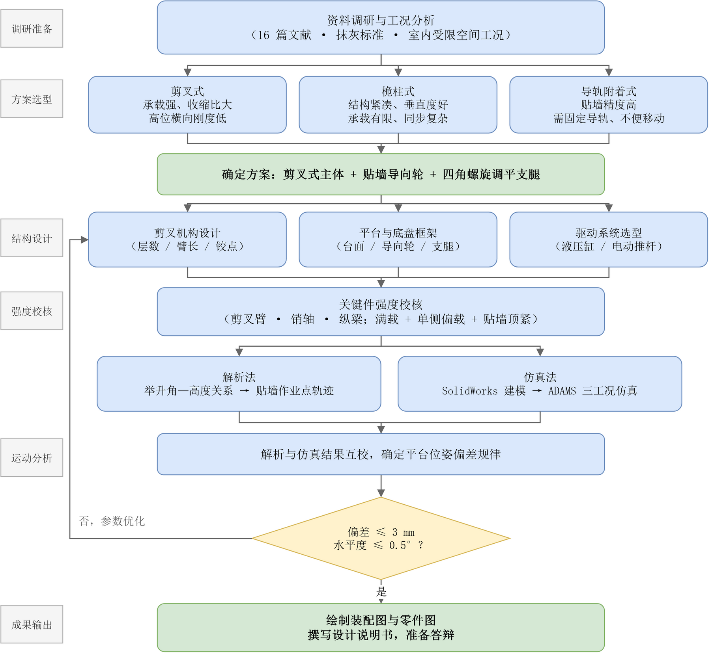

# 开题报告正文

## 一、调研资料的准备

本课题自接到任务起，围绕“室内粉墙”这一具体施工场景开展了为期两周的资料调研，调研工作按“先场景、后装备、再方法”的顺序展开。

首先明确作业场景。经查阅《建筑装饰装修工程质量验收标准》GB 50210 与《抹灰砂浆技术规程》JGJ/T 220，室内一般抹灰的层厚为 15 至 20 mm，普通抹灰的表面平整度允许偏差为 4 mm，高级抹灰为 3 mm。这一验收指标是后续结构设计与运动分析的公差来源：升降平台的位姿偏差与结构变形必须控制在这一量级之内，否则抹灰头再精确也无法保证质量。

其次检索装备资料。以“粉墙机”“自动抹灰机”“抹墙机”“升降平台”“剪叉机构”“高空作业平台”为检索词，在知网、万方、维普、国家科技期刊平台以及 CNKI 手机版文章页进行组合检索，并以 Crossref 补充外文文献，累计获得与本题直接相关的文献 16 篇，其中期刊论文 14 篇（含英文 3 篇）、学位论文 1 篇、专著 1 篇，2021 年以后的文献占 69%。此外还查阅了《机械设计手册》《机械设计》《机械原理》等工具书，用以确定剪叉臂、铰点销轴、液压缸或电动推杆的选型与校核方法。

第三是梳理标准与规范。与本课题直接相关的标准除上述两项外，还有 GB/T 25849—2010《移动式升降工作平台 设计计算、安全要求和测试方法》，该标准规定了升降平台的稳定性计算、结构强度、安全装置与试验方法，是本课题稳定性校核与安全设计的主要依据；此外还参考了 GB/T 700《碳素结构钢》与 GB/T 6892《一般工业用铝及铝合金挤压型材》，用于材料选择。

调研得出的基本判断是：抹灰机械的整机研究已相对充分，抹灰头的喷浆、压实、抹平机构均有成熟方案，但承载抹灰头的升降平台长期被简化处理，针对室内受限空间、贴墙作业、单侧偏载的专用化平台研究基本空白。这既说明本课题有明确的研究空间，也说明不能简单套用通用高空作业平台，必须从粉墙工艺约束出发重新做结构方案。

## 二、设计的目的与要求

### 1. 设计目的

本课题的直接目的，是设计一台能在室内受限空间中完成粉墙作业的升降平台，并对其运动特性做出定量分析。具体可从三个层面表述。

在工程层面，用机械平台替代脚手架和马凳，把抹灰作业从“人随墙走、人随高度走”变为“设备就位、平台升降”，既降低高处作业的坠落风险，也把抹灰层的厚度均匀性从依赖工人手感转为由平台的运动精度保证。

在知识层面，通过完整走一遍“工况分析—方案比较—结构设计—强度校核—运动分析—图纸绘制”的流程，把机械原理中的机构运动分析、机械设计中的连接与传动设计、理论力学中的受力分析、以及 CAD/CAE 工具的使用串成一条线，形成对机械产品设计的整体认识。

在能力层面，重点训练三项能力：一是从工艺约束反推结构参数的能力，即把“抹灰层厚度公差 ±2 mm”翻译成“平台位姿偏差与结构变形限值”；二是用解析法与仿真法互相印证的能力；三是按国家标准绘制装配图与零件图、并规范表达技术要求的工程表达能力。

### 2. 设计要求

依据任务书与调研结论，本课题的设计要求量化如下。

（1）适用工况：室内层高 3.0 至 4.5 m，作业面为连续竖直墙面，门洞净宽不小于 0.8 m，地面平整度偏差不大于 10 mm/2 m。

（2）主要参数：额定载荷 200 kg（含操作人员 1 人、砂浆桶及工具）；平台台面尺寸约 1200 mm×600 mm；最大举升高度 4.0 m；升降速度 0.08 至 0.15 m/s，且可无级调节；整机收缩高度不大于 1.6 m；整机质量不超过 180 kg。

（3）贴墙要求：平台前缘与墙面的间隙可在 20 至 50 mm 内调整，平台台面与墙面在全行程内的平行度偏差不大于 3 mm。

（4）调平要求：就位后在 3° 以内的地面坡度下完成调平，调平后平台水平度偏差不大于 0.5°。

（5）安全要求：按 GB/T 25849—2010 进行抗倾覆稳定性计算，最不利工况下的稳定系数不小于 1.5；设置机械式防坠与限位装置；液压或电动驱动系统具备断电自锁能力。

（6）成果要求：完成装配图 1 张（A0）、主要零件图 3 至 4 张（A3）、三维模型一套、运动仿真分析报告一份、毕业设计说明书一份（不少于 8000 字）。

## 三、设计的思路与预期成果

### 1. 设计的思路

总体思路是“以剪叉机构为主体、以贴墙导向与调平为补充、以解析法与仿真法互校为手段”。具体分五步推进。

第一步，方案比较与选型。对剪叉式、桅柱式、导轨附着式三种结构形式从承载能力、收缩高度、贴墙精度、室内通过性、成本五个维度做对比。剪叉式承载能力强、收缩比大、结构成熟，但高位横向刚度低、无法主动贴墙；桅柱式结构紧凑、垂直度好，但承载能力有限、多级伸缩的同步控制复杂；导轨附着式贴墙精度最高，但需要在墙面固定导轨，破坏了“免安装、可移动”的使用前提。综合比较后选定剪叉式为主体，并通过附加机构弥补其短板。

第二步，针对剪叉式短板做机构补充。针对“高位横向刚度低”，在平台四角设置可伸缩的贴墙导向轮，导向轮顶住墙面形成附加约束，把悬臂受力状态改为两点支承状态，既提高了横向刚度，又保证了平台与墙面的定距；针对“无法主动贴墙”，把导向轮做成丝杠调节式，实现 20 至 50 mm 的间隙调整；针对“地面不平引起初始倾斜”，在底盘四角设置螺旋式调平支腿，配合气泡水平仪或倾角传感器完成调平。

第三步，结构设计与强度校核。确定剪叉层数（初定 3 层）、剪叉臂长度与铰点布置、平台与底盘的框架结构，完成液压缸或电动推杆的选型与安装位置优化；对剪叉臂、铰点销轴、底盘纵梁三个关键件做受力分析与强度校核，按最不利工况（满载 + 单侧偏载 + 贴墙顶紧）计算。

第四步，运动分析。先用解析法建立举升角、驱动行程与平台高度的关系，进而推导平台前缘贴墙作业点的运动轨迹，求出其与理想竖直线的水平偏差随高度的变化规律；再在 SolidWorks 中建立三维模型，导入 ADAMS 建立多体动力学模型，对空载、额定载荷、单侧偏载三种工况做仿真，提取铰点力曲线与平台位姿偏差曲线，与解析结果互相印证。解析法保证物理意义清晰、便于参数化讨论，仿真法保证能反映铰接间隙、构件柔性等解析法难以处理的因素，两者互补。

第五步，图纸绘制与说明书撰写。按国家标准绘制装配图与零件图，标注配合、公差与技术要求；整理计算过程与仿真结果，形成说明书。

上述五步之间的关系如图1所示。

### 2. 预期成果

（1）文献综述一篇，不少于 3000 字，已完成；

（2）开题报告一份，不少于 2000 字，即本文；

（3）升降平台装配图 1 张（A0），包含主视图、俯视图、左视图及主要技术特性表；

（4）主要零件图 3 至 4 张（A3），含剪叉臂、铰点销轴、平台框架、导向轮支架；

（5）三维实体模型一套，含整机装配与运动仿真动画；

（6）运动学与动力学分析报告一份，含解析推导、ADAMS 仿真曲线、三种工况对比；

（7）毕业设计说明书一份，不少于 8000 字，含摘要、目录、方案论证、结构设计、强度校核、运动分析、结论与参考文献。

### 3. 图表的规范化

（1）图的规范化。装配图与零件图按 GB/T 4457—2002 至 GB/T 4460—1984 系列标准绘制，图幅、比例、线型、字体、尺寸标注均符合制图国家标准；说明书中插图的宽度不超过 15 cm，图中量的意义在正文中加以解释；曲线图的横纵坐标采用国际标准符号，物理量符号用斜体，单位用正体并以“/”与量纲隔开，刻度线置于框内侧，标值取 3 位有效数字。

（2）表格的规范化。表格采用三线表，小表宽度小于 7.5 cm，大表宽度 12 至 15 cm；表身中同一栏各行的数值以小数点对齐、有效位数相同；表中“量”的意义在正文中加以解释。方案比较表、参数汇总表、强度校核结果表均按此规范编排。

（3）量与单位的书写。正文、图表中的变量均用斜体字母，矢量与张量用黑斜体；单位符号用正体，来源于人名的单位符号首字母大写；公式用公式编辑器输入，公式主体排在同一水平线上，长公式在运算符号后回行。

## 四、任务完成的阶段内容及时间安排

1周~2周   熟悉题目，搜集资料，完成文献综述（16 篇文献，含英文 3 篇）；

3周~4周   完成开题报告并参加开题答辩，确定结构方案与主要参数；

5周~6周   完成剪叉机构、贴墙导向机构、调平支腿的结构设计与参数计算；

7周~8周   完成驱动系统选型、关键件强度校核，绘制装配图与零件图初稿；

9周~10周  建立三维模型，完成运动学解析推导；

11周~12周 用 ADAMS 完成三种工况的动力学仿真，与解析结果对比，优化结构参数；

13周~14周 整理计算与仿真结果，撰写说明书，修改图纸，准备答辩。

## 五、完成设计（论文）所具备的条件因素

课程基础方面，本人已修完机械原理、机械设计、机械设计基础课程设计、理论力学、材料力学、工程材料、机械制造技术基础、液压与气压传动、机械系统动力学等课程，掌握了机构运动分析、零部件强度校核、传动系统设计的基本方法，能够独立完成剪叉机构的运动学推导与关键件校核。

工具条件方面，能够熟练使用 AutoCAD 绘制二维装配图与零件图，使用 SolidWorks 完成三维建模与装配，使用 ADAMS 进行多体动力学仿真，使用 MATLAB 完成解析式的数值计算与曲线绘制。学校机房与实验室提供了上述正版软件的使用条件。

资料条件方面，学校图书馆已订购知网、万方、维普等数据库，可获取本课题所需的全部中英文文献；《机械设计手册》《机械设计》《机械原理》等工具书与国家标准可在图书馆借阅或在线查询。

指导与实测条件方面，指导教师长期从事机械结构设计与机构分析方向的教学科研工作，能够在方案论证与仿真分析环节提供指导；学院实验室具备游标卡尺、百分表、水平仪等测量工具，可对加工出的剪叉臂、销轴进行尺寸与形位公差检测，为误差分析提供实测依据。

综上，本课题所需的知识、工具、资料与指导条件均已具备，能够按计划完成设计任务。
